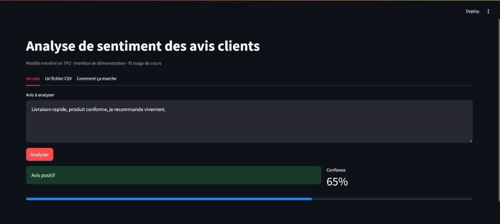
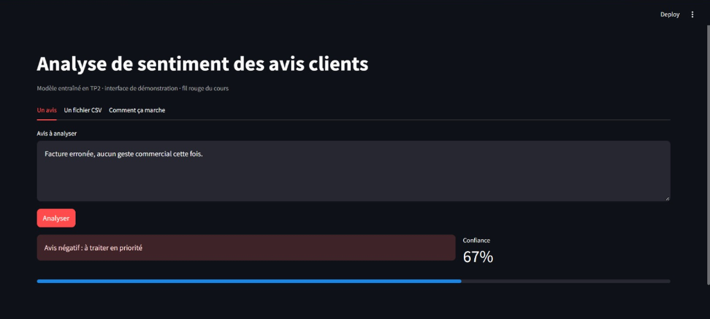

# Compte rendu global des TP1, TP2 et TP3
## Du cadrage métier à l'interface de démonstration

**Binôme :** Manal Wassila ([@manalwassila](https://github.com/manalwassila)) et Hiba Ayatallah ([@HibaAyatallah](https://github.com/HibaAyatallah))  
**Dépôt :** [https://github.com/HibaAyatallah/Hiba_Ayatallah---Manal_Wassila](https://github.com/HibaAyatallah/Hiba_Ayatallah---Manal_Wassila)  
**Date :** 14 octobre 2026  
**Module :** Développement et déploiement d'applications intelligentes — Pr. A. Larhlimi  

---

## 1. Le besoin et son cadrage

### 1.1 Le problème métier
Une équipe de relation client reçoit chaque jour un flux massif de milliers d'avis de consommateurs (retours produits, incidents logistiques, demandes de support). Dans l'organisation initiale en file d'attente FIFO (*First In, First Out*), les réclamations urgentes et les avis négatifs sévères attendent plusieurs jours avant d'être pris en charge. Cette latence aggrave l'insatisfaction client, favorise l'attrition (*churn*) et porte atteinte à l'image de marque de l'entreprise.

L'objectif de l'application est d'inverser ce paradigme : filtrer et classer automatiquement les avis dès leur réception pour propulser les avis négatifs en tête de file de traitement, tout en isolant les cas ambigus pour qu'ils soient revus par un conseiller humain.

### 1.2 Justification de l'approche technique pour le Cas 3 (Avis négatifs)
L'évaluation multicritère formalisée au cours du TP1 a conduit au choix exclusif du **Machine Learning supervisé classique** (traitement du langage naturel statistique) pour répondre à ce besoin, face aux alternatives (règles métier, RAG ou modèles génératifs purs) :

- **(a) Données étiquetées disponibles sans surcoût :** Les plateformes d'e-commerce collectent nativement une note numérique (de 1 à 5 étoiles) en regard du commentaire textuel. La conversion de ces notes en étiquettes binaires (1-2 étoiles = négatif, 4-5 étoiles = positif) fournit instantanément des dizaines de milliers d'exemples annotés pour l'apprentissage supervisé, sans mobiliser d'équipe d'annotation dédiée.
- **(c) Coût d'inférence et volumétrie élevée :** Pour absorber des milliers d'appels quotidiens, un appel à une API de modèle génératif commercial (LLM) représenterait une dépense mensuelle disproportionnée et introduirait une latence de plusieurs secondes par requête. À l'inverse, un modèle classique TF-IDF couplé à une régression logistique s'exécute en quelques millisecondes sur CPU standard pour un coût marginal strictement nul.
- **(d) Conséquence modérée d'une erreur d'aiguillage :** L'algorithme ne valide pas une transaction financière ni un diagnostic médical ; il réordonne une file de tâches. Un faux positif (avis positif priorisé par erreur) ne lèse aucun client ; un faux négatif (avis négatif traité dans l'ordre ordinaire) ne dégrade pas le service par rapport à la situation historique. L'erreur est donc peu grave et rend le recours au Machine Learning particulièrement adapté, d'autant plus qu'un seuil de confiance isole les avis incertains.
- **(b) Explicabilité suffisante et auditabilité :** Les poids vectoriels et les coefficients de la régression logistique permettent d'extraire les termes les plus prédictifs pour chaque classe, garantissant une compréhension claire des décisions algorithmiques pour les superviseurs métier.

---

## 2. L'architecture du dépôt et principes MLOps

### 2.1 Organisation modulaire du dépôt
Le dépôt `sentiment-app` structure rigoureusement les responsabilités pour garantir la testabilité, la reproductibilité et l'isolation des composants :

```text
sentiment-app/
├── README.md, TP1-ENONCE.md, TP2-ENONCE.md, TP3-ENONCE.md, MARCHE-A-SUIVRE*.md
├── requirements.txt, requirements.lock, .gitignore, pytest.ini, Makefile
├── .github/workflows/ci.yml       # Intégration continue (GitHub Actions)
├── docs/                          # Spécifications de cadrage et synthèses
│   ├── cadrage/                   # cas1-pharmacie.md, cas2-reglement.md, cas3-avis-negatifs.md
│   ├── semaine2.md                # Analyse qualitative des erreurs du modèle
│   └── semaine3.md                # Choix et argumentation du seuil d'incertitude
├── Resume/                        # Rapports et livrables de synthèse
│   ├── RESUME_TP1.pdf             # Synthèse TP1
│   ├── RESUME_TP2.md             # Synthèse TP2
│   └── RESUME_GLOBAL.md           # Le présent compte rendu global (TP1 à TP3)
├── src/                           # Pipeline ML d'entraînement et d'inférence (TP2)
│   ├── make_demo.py               # Générateur du jeu synthétique de démo
│   ├── train.py                   # Entraînement scikit-learn (démo et Allociné)
│   ├── evaluate.py                # Rapport de classification et matrice de confusion
│   └── predict.py                 # Logique pure d'inférence unitaire
├── ui/                            # Interface utilisateur Streamlit (TP3)
│   ├── app.py                     # Composants visuels, onglets, graphiques Streamlit
│   └── helpers.py                 # Fonctions pures (prédiction, seuillage, résumé de lot)
├── tests/                         # Suite complète de 45 tests automatisés
│   ├── test_environment.py       # 23 tests de structure et d'environnement (TP1)
│   ├── test_cadrage.py           # 12 tests de conformité des fiches (TP1)
│   ├── test_git_history.py       # 3 tests d'historique et de contribution binôme (TP1)
│   ├── test_model.py             # 4 tests sur le modèle et metrics.json (TP2)
│   └── test_ui.py                # 3 tests sur la logique de l'interface (TP3)
├── models/                        # Artefacts de modélisation
│   ├── .gitkeep                   # Préservation du répertoire dans Git
│   ├── metrics.json               # Métriques validées et versionnées
│   └── sentiment.joblib           # Fichier binaire du modèle (local, ignoré par Git)
└── data/                          # Données d'expérimentation
    ├── sample_reviews.csv         # Échantillon de test opérationnel (30 avis)
    └── demo_reviews.csv          # Données de démo (290 avis régénérables)
```

### 2.2 Stratégie MLOps : Versionnage sélectif et reproductibilité
Un logiciel traditionnel ne versionne que du code source. Une application intelligente manipule trois natures d'artefacts distinctes :

| Artefact | Présent dans Git ? | Justification |
| :--- | :---: | :--- |
| **Le code source** (`src/`, `ui/`, `tests/`) | **Oui** | C'est le cœur reproductible du travail d'ingénierie. |
| **L'environnement** (`.venv/`) | **Non** | Reconstructible instantanément via `pip install -r requirements.txt`. Son inclusion alourdirait le dépôt de plusieurs centaines de Mo. |
| **Les données** (`demo_reviews.csv`) | **Non** | Régénérables à la demande en une commande (`python src/make_demo.py`). |
| **Le modèle sérialisé** (`sentiment.joblib`) | **Non** | Fichier binaire lourd, inadapté aux diffs Git, et régénérable fidèlement via `python src/train.py --allocine` grâce à la fixation de la graine aléatoire (`random_state=42`). |
| **La mesure de performance** (`metrics.json`) | **OUI** | Fichier texte léger contenant les scores officiels validés. Elle ne peut être recalculée sans ré-entraîner. |

### 2.3 Pourquoi `models/metrics.json` est dans Git et pas `models/sentiment.joblib` ?
Cette règle répond directement aux exigences de l'intégration continue (CI) :
- **Transporter la preuve de conformité sans le poids du binaire :** Sur les serveurs GitHub Actions, la machine virtuelle d'intégration exécute les tests sur un environnement éphémère. Les tests `test_metriques_completes` et `test_f1_au_dessus_du_seuil` valident la qualité du travail en lisant `metrics.json`. Si le modèle `sentiment.joblib` est absent, les tests de prédiction directe sont simplement ignorés (`pytest.skip`).
- **Traçabilité des performances dans l'historique :** Chaque ré-entraînement enregistre formellement ses métriques (date, volume de données, F1 macro, exactitude, rappel négatif). Un commit permet ainsi d'auditer l'amélioration ou la régression du modèle sans polluer l'historique Git avec des binaires incompatibles.

---

## 3. Le modèle de sentiment

### 3.1 Pipeline scikit-learn et étanchéité des données
Le modèle est conçu sous forme d'un `Pipeline` scikit-learn garantissant que la même chaîne de traitement s'applique rigoureusement à l'apprentissage et en inférence :
1. **`TfidfVectorizer` :**
   - Combinaison d'unigrammes et de bigrammes (`ngram_range=(1, 2)`) pour capturer des associations lexicales locales (ex. « pas bon », « très rapide »).
   - Filtrage des termes rares avec `min_df=2`.
   - Normalisation logarithmique des fréquences (`sublinear_tf=True`).
2. **`LogisticRegression` :**
   - Pondération inverse des classes (`class_weight="balanced"`) pour compenser tout déséquilibre.
   - Algorithme d'optimisation robuste avec `max_iter=1000` et `random_state=42`.

> **Point méthodologique fondamental :** Le découpage `train_test_split` (80 % train, 20 % test, stratifié sur les classes) intervient **strictement avant toute vectorisation**. Si le vectoriseur apprenait sur l'intégralité du corpus, le vocabulaire du jeu de test « fuiterait » dans l'entraînement (*data leakage*), faussant la validité des scores.

### 3.2 Résultats chiffrés réels : Démonstration vs Allociné

| Métrique / Paramètre | Jeu de Démonstration (`demo`) | Vrai Jeu Public (`allocine`) |
| :--- | :---: | :---: |
| **Source des données** | `data/demo_reviews.csv` | Validation Allociné (Parquet) |
| **Volume total d'avis** | 290 avis | 20 000 avis |
| **Nombre d'avis d'entraînement** | 232 avis | 16 000 avis |
| **Nombre d'avis de test** | 58 avis | 4 000 avis |
| **Taille du vocabulaire appris** | 316 termes | **149 529 termes** |
| **Exactitude globale (*Accuracy*)** | 87.93 % | **92.05 %** |
| **Score $F_1$ macro** | **0.879** | **0.9205** (seuil exigé : 0.85) |
| **Rappel sur la classe négative** | **93.10 %** (27 / 29) | **91.13 %** |
| **Précision sur la classe négative** | 84.38 % (27 / 32) | 93.19 % |

Sur le jeu réel Allociné, l'explosion du vocabulaire (multiplié par près de 470) permet au modèle d'atteindre un score $F_1$ macro de **0.9205**, surpassant très nettement le seuil d'exigence fixé à 0.85.

### 3.3 Analyse de la matrice de confusion (Jeu de démo)
Sur les 58 avis du jeu de test de démonstration, la matrice de confusion mesurée est la suivante :

```text
                  Prédiction : negative    Prédiction : positive
Vérité : negative                   27                        2
Vérité : positive                    5                       24
```

- **Ligne 1 (Vérité = négatif, 29 avis) :**
  - **27 vrais négatifs (TN) :** 93.1 % des avis mécontents sont correctement détectés pour être remontés en tête de file.
  - **2 faux positifs (FP) :** Deux avis négatifs sont classés positifs. C'est l'erreur la plus coûteuse pour le métier, car ces clients mécontents subiront le délai de traitement ordinaire.
- **Ligne 2 (Vérité = positif, 29 avis) :**
  - **5 faux négatifs (FN) :** Cinq avis favorables sont étiquetés négatifs. Ils sont placés à tort dans la file prioritaire mais seront rapidement traités par un agent sans conséquence néfaste.
  - **24 vrais positifs (TP) :** 82.8 % des clients satisfaits sont correctement identifiés.

---

## 4. L'analyse des erreurs

### 4.1 Diagnostic et inventaire des erreurs
Sur les 58 avis de démo, le modèle commet exactement **7 erreurs**. L'examen systématique démontre que **100 % des erreurs surviennent sur des avis mitigés** comportant une première proposition d'un sentiment, un connecteur d'opposition, puis une conclusion du sentiment inverse.

Exemples réels extraits directement de nos données d'évaluation :
1. *« Taille trop petite et retour payant au déballage, sauf que ensuite produit conforme à la description. »*  
   $\rightarrow$ Vérité = positive, Prédit = negative.
2. *« Commande jamais reçue et remboursement en attente au début, sauf que ensuite je recommande vivement. »*  
   $\rightarrow$ Vérité = positive, Prédit = negative.
3. *« Service impeccable et livraison en avance sur le papier, sauf que ensuite produit cassé à l'arrivée. »*  
   $\rightarrow$ Vérité = negative, Prédit = positive (cas critique).

### 4.2 Le mécanisme générateur : l'absence d'ordre du sac de mots
L'extraction TF-IDF repose sur le paradigme du « sac de mots » (*bag-of-words*) :
- Le modèle additionne les poids des mots indépendamment de leur position dans la phrase.
- Dans l'exemple 3, les termes élogieux (*impeccable*, *livraison en avance*, *service*) pèsent plus lourd numériquement que le seul terme *cassé*.
- Le modèle est structurellement incapable de comprendre que la proposition introduite par *« sauf que ensuite »* annule la proposition précédente. Pour un modèle sans ordre, l'expression *« bon puis mauvais »* et l'expression *« mauvais puis bon »* produisent rigoureusement le même vecteur de caractéristiques.

### 4.3 Pistes de remédiation technique
Pour corriger ces erreurs sans complexité inutile :
1. **Surpondération positionnelle :** Attribuer un poids croissant aux n-grammes situés vers la fin du texte, là où réside la conclusion.
2. **Segmentation par marqueurs discursifs :** Scinder le texte au niveau des conjonctions d'opposition (*mais*, *cependant*, *sauf que*) et orienter la prédiction sur la clause finale.
3. **Modèles de langue séquentiels (Transformers) :** L'emploi d'un modèle pré-entraîné comme **CamemBERT**, dont les couches d'auto-attention bidirectionnelle et les encodages positionnels capturent la syntaxe et la négation à longue portée.

---

## 5. L'interface Streamlit et l'arbitrage du seuil d'incertitude

### 5.1 Séparation stricte de la logique et de l'affichage
L'un des acquis majeurs du TP3 est l'architecture en deux modules :
- **`ui/helpers.py` (Logique pure) :** Fonctions indépendantes de tout framework web (`charger_predicteur`, `classer`, `predire_lot`, `resumer`). Ce découpage permet à la suite de tests automatisés (`tests/test_ui.py`) de valider la logique métier en une seconde sans jamais avoir à instancier Streamlit.
- **`ui/app.py` (Composants visuels) :** Rendu visuel interactif, organisation en onglets, mise en cache du modèle lourd via `@st.cache_resource` pour éviter les relectures disques inutiles à chaque interaction utilisateur.

### 5.2 Les fonctionnalités développées
1. **Onglet « Un avis » :** Zone de saisie dynamique affichant la jauge de confiance et le code couleur adapté (vert pour positif, rouge pour négatif prioritaire, orange pour arbitrage agent).
2. **Onglet « Un fichier CSV » :** Traitement batch permettant de glisser-déposer un export d'avis, de visualiser les 3 métriques produit immédiates, d'explorer le tableau trié des avis urgents et de télécharger le CSV annoté.
3. **Onglet « Comment ça marche » :** Guide pédagogique transparent expliquant aux conseillers relation client le fonctionnement et les limites du modèle.

#### Illustrations de l'interface Streamlit en conditions réelles
| Détection d'un avis favorable (Confiance élevée) | Détection d'un avis négatif (Traitement prioritaire) |
| :---: | :---: |
|  |  |
*Figure 1 : Interface utilisateur en action démontrant la jauge de probabilité, le diagnostic immédiat et l'orientation des retours clients.*

### 5.3 Analyse chiffrée et justification du seuil d'incertitude
La constante `SEUIL_INCERTITUDE` dans `ui/helpers.py` régit la bascule entre l'automatisation totale et l'intervention humaine. Nous avons évalué l'impact de ce paramètre :

| Seuil d'incertitude | Avis « à vérifier » (sur 290 démo) | Avis « à vérifier » (sur 30 sample) | Risque opérationnel |
| :---: | :---: | :---: | :--- |
| **0.50** | ~ 40 avis (14 %) | 1 avis (3 %) | Risque élevé : le modèle tranche seul des avis mitigés et commet des faux négatifs critiques. |
| **0.60 (Retenu)** | **117 avis (40.3 %)** | **7 avis (23.3 %)** | **Compromis idéal :** isole les avis ambigus tout en automatisant en toute sécurité 75 à 85 % des flux nets. |
| **0.75** | > 190 avis (> 65 %) | 18 avis (60 %) | Surcharge humaine : la file de vérification déborde, l'automatisation perd sa valeur ajoutée. |

**Justification métier :**  
Le seuil de **0.60** constitue le point d'équilibre optimal pour l'équipe relation client. Sur des avis ordinaires (`sample_reviews.csv`), il automatise plus de 75 % du traitement sans risque. Sur des avis volontairement difficiles et mitigés (`demo_reviews.csv`), il renvoie 40 % des dossiers vers un conseiller, capturant la quasi-totalité des 7 erreurs identifiées au TP2.

---

## 6. Ce qui a échoué (Difficultés réelles et résolutions)

La réalisation des trois séances a été jalonnée de plusieurs incidents concrets résolus avec méthode :

1. **Incompatibilité de l'interpréteur système sous Windows (TP1) :**
   - *Incident :* L'appel initial `python -m pytest` a échoué avec l'erreur `C:\Python313\python.exe: No module named pytest`.
   - *Cause :* Le terminal utilisait le Python global de la machine (3.13) au lieu de l'environnement virtuel du projet.
   - *Solution :* Exécution ciblée via le chemin explicite `.\.venv\Scripts\python.exe` et activation de la politique de scripts PowerShell via `Set-ExecutionPolicy RemoteSigned`.
2. **Échec attendu du contrôle C1 au TP2 :**
   - *Incident :* Lors de l'installation du kit TP2, `pytest` a affiché `2 failed, 38 passed, 2 skipped`.
   - *Cause :* Les tests de `test_model.py` cherchaient `models/metrics.json` avant que l'entraînement n'ait eu lieu.
   - *Solution :* Lancement immédiat de `python src/train.py`, produisant les métriques et faisant repasser la suite au vert.
3. **Rejet de push Git par divergence distante (TP2) :**
   - *Incident :* Erreur `! [rejected] main -> main (fetch first)` lors du push du commit Semaine 2.
   - *Cause :* La collaboratrice du binôme avait ajouté un fichier de compte rendu PDF directement sur l'interface GitHub, créant un commit distant non présent en local.
   - *Solution :* Rapatriement par `git fetch origin` suivi d'un `git rebase origin/main` propre pour rejouer notre commit au sommet de la branche sans polluer l'historique avec un merge commit.
4. **Optimisation des performances Streamlit (TP3) :**
   - *Incident :* Latence perceptible lors de chaque clic dans l'interface web.
   - *Cause :* Le script Streamlit se réexécute intégralement à chaque interaction, rechargeant le modèle `.joblib` en mémoire à chaque saisie.
   - *Solution :* Encapsulation du chargement dans une fonction décorée avec `@st.cache_resource`, garantissant un chargement unique en mémoire vive.

---

## 7. Ce que nous ferions autrement

Avec le recul de ces trois séances et dans un contexte d'ingénierie logicielle d'entreprise :
1. **Intégration d'un outil de versionnage de données (DVC) :** Plutôt que de reposer sur un script de régénération manuel, coupler Git à DVC et un bucket cloud (S3 / GCS) permettrait de lier formellement chaque version du modèle au hash exact des données d'entraînement.
2. **Déploiement découplé via une API REST (FastAPI) :** Séparer l'interface Streamlit du modèle en déployant ce dernier derrière un microservice FastAPI containerisé avec Docker. Cela permettrait à d'autres applications de l'entreprise (CRM, ERP, application mobile) de consommer les prédictions via un endpoint unique.
3. **Surveillance continue de la dérive lexicale (*Data & Concept Drift*) :** En production, le langage des utilisateurs et les produits évoluent continuellement. L'intégration d'un moniteur de dérive (ex. Evidently AI) analyserait l'évolution des scores de confiance pour déclencher des alertes et des ré-entraînements automatisés.

---

## 8. Répartition du travail au sein du binôme

Le travail a été réalisé en binôme équilibré et complémentaire tout au long des trois séances :

| Membre | Contributions détaillées sur les 3 TP |
| :--- | :--- |
| **Manal Wassila** | - Configuration de l'environnement virtuel local et des dépendances.<br>- Exécution des scripts d'entraînement démo et Allociné, analyse des métriques de classification.<br>- Développement des fonctions pures de `ui/helpers.py`, implémentation de l'interface Streamlit et tests unitaires `test_ui.py`.<br>- Résolution des incidents Git et maintien du dépôt à 45 tests validés. |
| **Hiba Ayatallah** | - Cadrage méthodologique des cas 1, 2 et 3, rédaction des fiches de décision conformes.<br>- Création et administration du dépôt GitHub distant, gestion des collaborateurs et des droits.<br>- Évaluation qualitative des erreurs du modèle sur les avis mitigés et rédaction des rapports de synthèse.<br>- Recette fonctionnelle de l'interface Streamlit et validation des seuils métier. |

---

## Outils d'aide à la rédaction

Conformément à la politique d'intégrité académique, nous déclarons avoir utilisé l'assistant d'IA Antigravity pour nous aider à structurer la mise en forme Markdown, à concevoir les tableaux comparatifs et à vérifier la cohérence des chiffres réels issus de notre fichier `models/metrics.json` ; l'ensemble du travail technique, des commandes, de l'analyse des résultats et des choix d'ingénierie a été réalisé, vérifié et validé par nos soins.
