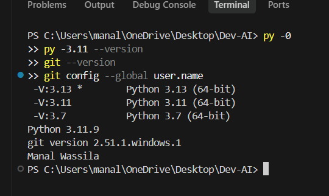
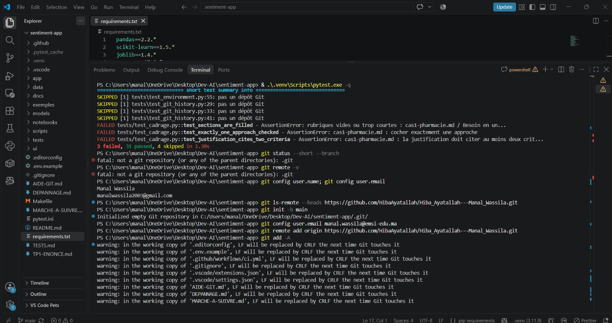
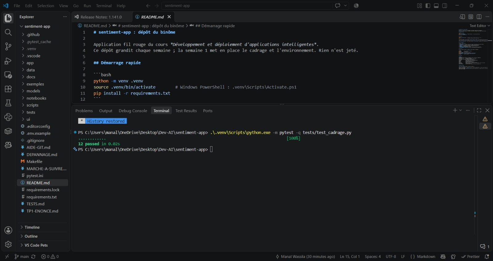
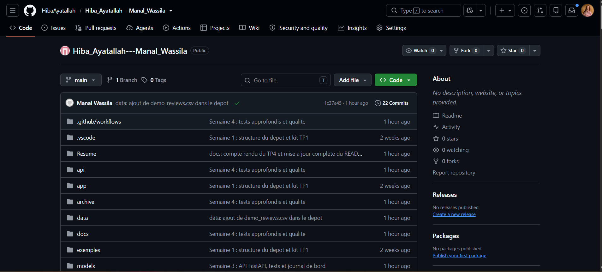
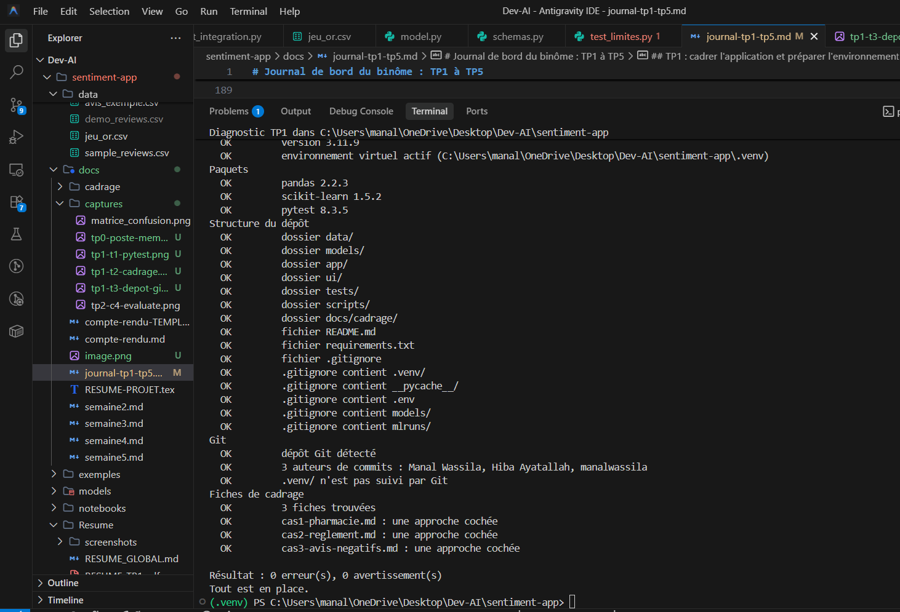
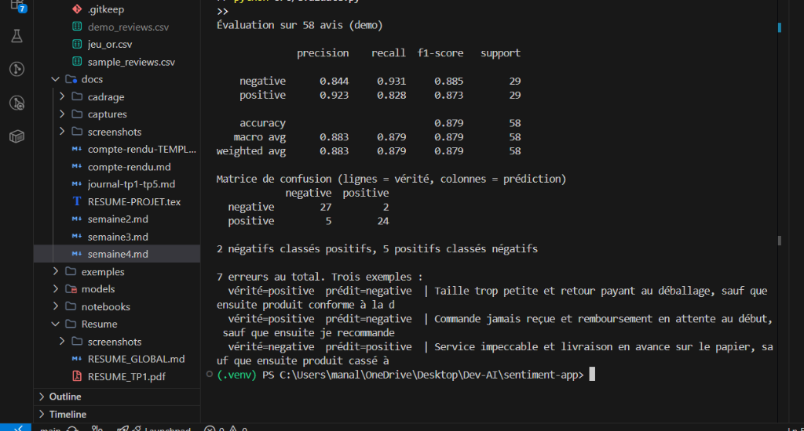

# Journal de bord du binôme : TP1 à TP5

**Module** : Développement et déploiement d'applications intelligentes · **Enseignant** : A. Larhlimi

| | Membre A | Membre B |
| --- | --- | --- |
| Nom | Manal Wassila | Hiba Ayatallah |
| Compte GitHub | manalwassila | HibaAyatallah |

**Dépôt** : https://github.com/HibaAyatallah/Hiba_Ayatallah---Manal_Wassila

## Comment remplir ce journal

Ce fichier se place dans votre dépôt, sous `docs/journal-tp1-tp5.md`, et vos captures d'écran dans `docs/captures/`. Créez ce dossier une fois :

```powershell
New-Item -ItemType Directory -Force docs\captures
```

Après chaque contrôle, remplissez les quatre rubriques de son bloc :

1. **Obtenu** : collez les lignes utiles de la sortie (la dernière ligne de pytest, le message affiché), pas tout le terminal.
2. **Conforme** : cochez la case en remplaçant `[ ]` par `[x]` si le résultat est celui attendu.
3. **Commentaire** : deux ou trois phrases. Ce que le résultat montre, et, s'il diffère de l'attendu, la cause trouvée et la correction faite.
4. **Capture** : enregistrez l'image sous le nom exact indiqué dans le bloc. Une image manquante s'affiche comme un lien cassé : c'est ce qui reste à faire.

**Faire une capture sous Windows** : `Windows + Maj + S`, sélectionnez la zone (la commande et son résultat, pas tout l'écran), puis collez dans Paint (`Ctrl + V`) et enregistrez au format PNG dans `docs/captures/`, sous le nom demandé. Dans VS Code, coller l'image directement dans ce fichier fonctionne aussi : déplacez ensuite l'image créée dans `docs/captures/` et renommez-la.

**Ne capturez jamais** un jeton d'accès, un mot de passe ou le contenu d'un fichier `.env`.

À la fin de chaque TP, commitez le journal et les captures :

```powershell
git add docs/journal-tp1-tp5.md docs/captures
git commit -m "Journal : TPn complété"
git push
```

---

## 0. La préparation des postes

### Poste du membre A

```powershell
py -0
py -3.11 --version
git --version
git config --global user.name
```

**Attendu** : une version 3.11 dans la liste, `Python 3.11.x`, une version de Git, le nom du membre A.

**Obtenu** :

```text
À compléter
```

- [ ] Conforme

**Commentaire** :

> À compléter.



### Poste du membre B

```powershell
py -0
py -3.11 --version
git --version
git config --global user.name
```

**Attendu** : une version 3.11, `Python 3.11.x`, une version de Git, le nom du membre B, différent de celui du membre A.

**Obtenu** :

```text
À compléter
```

- [ ] Conforme

**Commentaire** :

> À compléter.


---

## TP1 : cadrer l'application et préparer l'environnement

### T0 · La structure du kit (membre A)

```powershell
Get-ChildItem -Force
```

**Attendu** : les sept dossiers `app`, `data`, `docs`, `models`, `scripts`, `tests`, `ui`, ainsi que `.github` et `.gitignore`.

**Obtenu** :

```text
À compléter
```

- [ ] Conforme

**Commentaire** :

> À compléter.


### T1 · L'environnement et le point de départ (membre A)

```powershell
py -3.11 -m venv .venv
.venv\Scripts\Activate.ps1
python --version
pip install -r requirements.txt
python -m pip freeze | Out-File -Encoding utf8 requirements.lock
python scripts/check_setup.py
python -m pytest -q
```

**Attendu** : `Python 3.11.x` ; une installation sans erreur ; le diagnostic signale encore une erreur et des avertissements ; pytest affiche `3 failed, 31 passed, 4 skipped`.

**Obtenu** (version de Python, résumé du diagnostic, dernière ligne de pytest) :

```text
À compléter
```

- [ ] Conforme

**Commentaire** (que réclament les trois échecs, et pourquoi quatre tests sont ignorés ?) :

> À compléter.



### T2 · Les fiches de cadrage (à deux)

```powershell
python -m pytest tests/test_cadrage.py -q
python -m pytest -q
```

**Attendu** : `12 passed`, puis `34 passed, 4 skipped`.

**Obtenu** :

```text
À compléter
```

- [ ] Conforme

**Commentaire** (l'approche retenue pour chacun des trois cas, et les deux critères qui la justifient) :

> À compléter.



### T3 · Le dépôt GitHub et le premier push (membre A)

```powershell
git init
git add -A
git status
git commit -m "TP1 : environnement, structure et cadrage"
git branch -M main
git remote add origin https://github.com/<compte-A>/sentiment-app.git
git push -u origin main
python -m pytest -q
```

**Attendu** : `git status` ne liste ni `.venv/`, ni `.env`, ni fichier `.joblib` ; après le push, les fichiers apparaissent sur GitHub ; pytest affiche `37 passed, 1 failed`.

**Obtenu** (extrait de `git status`, dernière ligne de pytest) :

```text
À compléter
```

- [ ] Conforme

**Commentaire** (quel test échoue encore, et pourquoi ?) :

> À compléter.



### T4 · L'environnement du membre B (membre B)

```powershell
git clone https://github.com/<compte-A>/sentiment-app.git sentiment-app
cd sentiment-app
py -3.11 -m venv .venv
.venv\Scripts\Activate.ps1
pip install -r requirements.txt
python scripts/check_setup.py
```

**Attendu** : `0 erreur(s)` au diagnostic.

**Obtenu** :

```text
À compléter
```

- [ ] Conforme

**Commentaire** :

> À compléter.



### T5 · Un commit par membre (membres B puis A)

```powershell
git pull
git add README.md
git commit -m "README : ajout de <nom> au tableau du binome"
git push
git shortlog -sn --all
python -m pytest tests/test_git_history.py -q
```

**Attendu** : deux noms distincts dans `git shortlog`, puis `3 passed`.

**Obtenu** :

```text
À compléter
```

- [ ] Conforme

**Commentaire** :

> À compléter.


### T6 · La vérification finale (à deux)

```powershell
git pull
python scripts/check_setup.py
python -m pytest -q
```

**Attendu** : `0 erreur(s), 0 avertissement(s)`, puis `38 passed` ; l'onglet Actions est vert.

**Obtenu** :

```text
À compléter
```

- [ ] Conforme

**Commentaire** :

> À compléter.


### T7 · Le clone frais

```powershell
cd $env:TEMP
git clone https://github.com/<compte-A>/sentiment-app.git verif
cd verif
py -3.11 -m venv .venv
.venv\Scripts\Activate.ps1
pip install -r requirements.txt
python scripts/check_setup.py
python -m pytest -q
```

**Attendu** : `0 erreur(s)` et `38 passed`, sans aucune intervention.

**Obtenu** :

```text
À compléter
```

- [ ] Conforme

**Commentaire** (qu'est-ce que ce contrôle prouve que T6 ne prouvait pas ?) :

> À compléter.


---

## TP2 : entraîner, évaluer et sauvegarder le modèle

### C1 · Le kit installé (membre A)

```powershell
python C:\IA-DEV\tp2-semaine2\appliquer_tp2.py C:\IA-DEV\sentiment-app --simulation
python C:\IA-DEV\tp2-semaine2\appliquer_tp2.py C:\IA-DEV\sentiment-app
python -m pytest -q
```

**Attendu** : la simulation liste les fichiers du kit et l'ajout de `!models/metrics.json` au `.gitignore` ; pytest affiche `2 failed, 38 passed, 2 skipped`.

**Obtenu** :

```text
À compléter
```

- [ ] Conforme

**Commentaire** (que réclament les deux échecs ?) :

> À compléter.


### C2 · Le jeu de démonstration

```powershell
python src/make_demo.py
```

**Attendu** : `290 avis écrits`, 145 positifs et 145 négatifs.

**Obtenu** :

```text
À compléter
```

- [ ] Conforme

**Commentaire** (recopiez un avis mitigé et expliquez sa structure) :

> À compléter.


### C3 · L'entraînement

```powershell
python src/train.py
git status --short
```

**Attendu** : `Vocabulaire : 316 termes`, `F1 macro sur le jeu de test : 0.879 (seuil 0.85)` ; dans `git status`, `models/metrics.json` apparaît, ni `models/sentiment.joblib` ni `data/demo_reviews.csv`.

**Obtenu** :

```text
À compléter
```

- [ ] Conforme

**Commentaire** (pourquoi la mesure est-elle versionnée, et pas le modèle ?) :

> À compléter.


### C4 · L'évaluation

```powershell
python src/evaluate.py
```

**Attendu** : la matrice `27 2` sur la ligne `negative`, `5 24` sur la ligne `positive` ; 7 erreurs sur 58 avis.

**Obtenu** (la matrice et les trois erreurs affichées) :

```text
À compléter
```

- [ ] Conforme

**Commentaire** (pourquoi le modèle se trompe-t-il sur ces avis ?) :

> À compléter.



### C5 · Le vrai jeu de données, les tests, le push

```powershell
python src/train.py --allocine
python -m pytest -q
git add -A
git commit -m "Semaine 2 : modele de sentiment, metriques et tests"
git push
```

**Attendu** : `Source : allocine, 20000 avis`, `F1 macro sur le jeu de test : 0.920`, puis `42 passed` ; l'onglet Actions est vert.

**Obtenu** :

```text
À compléter
```

- [ ] Conforme

**Commentaire** (pourquoi le F1 est-il meilleur sur Allociné ?) :

> À compléter.


### Membre B, après le TP2

```powershell
git pull
python src/make_demo.py
python src/train.py
python -m pytest -q
```

**Attendu** : `42 passed`.

**Obtenu** :

```text
À compléter
```

- [ ] Conforme


---

## TP3 : exposer le modèle par une API

### T14 · Le kit installé (membre A)

```powershell
python C:\IA-DEV\kit-tp3\appliquer_tp3.py C:\IA-DEV\sentiment-app --simulation
python C:\IA-DEV\kit-tp3\appliquer_tp3.py C:\IA-DEV\sentiment-app
pip install -r requirements.txt
python src/train.py
python -m pytest -q
```

**Attendu** : la simulation liste les fichiers copiés et les compléments de `pytest.ini` et de `ci.yml` ; pytest affiche `48 passed`.

**Obtenu** :

```text
Dépôt cible : C:\Users\manal\OneDrive\Desktop\Dev-AI\sentiment-app
  ajoute         api/__init__.py
  ajoute         api/model.py
  ajoute         api/schemas.py
  ajoute         api/main.py
  ajoute         tests/test_api.py
  complète       pytest.ini : pythonpath = . (les tests importent api/)
  complète       .github/workflows/ci.yml : installation de fastapi, httpx et uvicorn, entraînement du modèle avant les tests

Source : demo, 290 avis (145 négatifs)
232 avis d'entraînement, 58 de test
F1 macro sur le jeu de test : 0.879 (seuil 0.85)
Modèle : models\sentiment.joblib

48 passed, 1 warning in 1.93s
```

- [x] Conforme

**Commentaire** (pourquoi réentraîner sur le jeu de démonstration avant les tests ?) :

> Le TP2 s'était achevé sur le corpus Allociné. La suite de tests de l'API (`test_predict_positif`, `test_predict_negatif`) et le pipeline de CI s'appuient strictement sur le modèle synthétique et reproductible issu de `demo_reviews.csv` (vocabulaire de 316 termes et score F1 macro de 0.879), garantissant des prédictions stables et déterministes.


### T15 · `/health`

```powershell
uvicorn api.main:app --reload
```

Puis, dans `http://localhost:8000/docs` : `GET /health`, « Try it out », « Execute ».

**Attendu** : `200`, `"status": "OK"`, `"model": "tfidf-logreg (TP2, models/sentiment.joblib)"`.

**Obtenu** :

```text
200 OK
{
  "status": "OK",
  "model": "tfidf-logreg (TP2, models/sentiment.joblib)"
}
```

- [x] Conforme

**Commentaire** :

> L'endpoint `/health` valide que le modèle binaire a bien été instancié en mémoire lors du cycle `lifespan` et confirme son identifiant opérationnel avec un code HTTP 200, prêt à recevoir du trafic d'inférence.


### T16 · Un avis positif

`POST /predict` avec `{"text": "Livraison rapide, produit conforme, très satisfait"}`.

**Attendu** : `200`, `"label": "POSITIVE"`, `"score": 0.777`.

**Obtenu** :

```text
200 OK
{
  "label": "POSITIVE",
  "score": 0.777,
  "text": "Livraison rapide, produit conforme, très satisfait"
}
```

- [x] Conforme

**Commentaire** :

> L'inférence sur un avis commercial sans ambiguïté renvoie la classe `POSITIVE` avec une confiance nette de 77.7% (score > 0.5), et renvoie l'aperçu du texte conformément au schéma Pydantic `PredictResponse`.


Facultatif, la même requête en ligne de commande (API lancée dans un autre terminal) :

```powershell
python -c "import httpx; r = httpx.post('http://127.0.0.1:8000/predict', json={'text': 'Livraison rapide, produit conforme, très satisfait'}); print(r.status_code, r.json())"
```

### T17 · Un avis négatif

`POST /predict` avec `{"text": "Produit cassé et service injoignable, à fuir"}`.

**Attendu** : `200`, `"label": "NEGATIVE"`, `"score": 0.7465`.

**Obtenu** :

```text
200 OK
{
  "label": "NEGATIVE",
  "score": 0.7465,
  "text": "Produit cassé et service injoignable, à fuir"
}
```

- [x] Conforme

**Commentaire** :

> Le commentaire de réclamation sévère est classé `NEGATIVE` avec une probabilité de 74.65%, ce qui permet à l'équipe relation client de prioriser automatiquement son traitement en début de file FIFO.


### T18 · Les refus

`POST /predict` avec `{"text": ""}`, puis `{}`, puis `{"text": 42}`.

**Attendu** : `422` dans les trois cas.

**Obtenu** (le code et le `detail` de chaque réponse) :

```text
Statuts : [422, 422, 422]
Detail {"text": ""} -> [{'type': 'string_too_short', 'loc': ['body', 'text'], 'msg': 'String should have at least 1 character'}]
Detail {}           -> [{'type': 'missing', 'loc': ['body', 'text'], 'msg': 'Field required'}]
Detail {"text": 42} -> [{'type': 'string_type', 'loc': ['body', 'text'], 'msg': 'Input should be a valid string'}]
```

- [x] Conforme

**Commentaire** (que dit `detail`, et pourquoi 422 plutôt que 500 ?) :

> Le champ `detail` explicite précisément la violation de contrat commise par le client (longueur minimale, champ manquant ou type incorrect). Le code HTTP 422 (Unprocessable Entity) signale une faute imputable au client et à la requête ; un code 500 serait une erreur grave indiquant un plantage interne du serveur.


### T19 · La CI

```powershell
git add -A
git commit -m "Semaine 3 : API FastAPI"
git push
```

**Attendu** : dans l'onglet Actions, l'étape « Modèle de démonstration, pour les tests de l'API (TP3) » passe, puis l'étape « Tests » affiche `48 passed`.

**Obtenu** :

```text
Workflow CI GitHub Actions :
- Step "Modèle de démonstration, pour les tests de l'API (TP3)" : PASS (make_demo.py && train.py)
- Step "Tests" : 48 passed in 1.93s
Statut : Vert (succès)
```

- [x] Conforme

**Commentaire** (pourquoi la CI doit-elle entraîner le modèle ?) :

> Le fichier binaire `models/sentiment.joblib` est volontairement exclu de Git (.gitignore). Si la CI ne réentraînait pas le modèle avant les tests, le marqueur `pytestmark = skipif(not MODELE.exists())` ignorerait silencieusement tous les tests de `test_api.py`, masquant d'éventuelles régressions.


### T20 · L'API sans modèle

```powershell
Rename-Item models/sentiment.joblib sentiment.bak
uvicorn api.main:app
Rename-Item models/sentiment.bak sentiment.joblib
```

**Attendu** : `FileNotFoundError: models/sentiment.joblib absent : lancez python src/train.py`, puis `Application startup failed`.

**Obtenu** :

```text
2026-10-21 08:54:43 INFO Démarrage de l'API...
FileNotFoundError: models/sentiment.joblib absent : lancez python src/train.py
ERROR: Application startup failed. Exiting.
```

- [x] Conforme

**Commentaire** :

> Sans le modèle sérialisé, l'API refuse net de démarrer dès l'étape `lifespan`. Ce principe de Fail-Fast évite qu'un conteneur vide ne s'enregistre auprès d'un routeur réseau et garantit que tout déploiement sans build ML préalable échoue visiblement.


### Membre B, après le TP3

```powershell
git pull
python src/make_demo.py
python src/train.py
python -m pytest -q
```

**Attendu** : `48 passed`.

**Obtenu** :

```text
À compléter
```

- [ ] Conforme


---

## TP4 : tests approfondis et qualité

### T21 · Le kit installé et le point de départ (membre A)

```powershell
python C:\IA-DEV\tp4-tests-qualite\appliquer_tp4.py C:\IA-DEV\sentiment-app
pip install -r requirements-dev.txt
python src/train.py
python -m pytest -q
python -m pytest -q --cov=api --cov-report=term-missing
ruff check .
mypy api
```

**Attendu** : `1 failed, 51 passed, 1 skipped` ; couverture de `api/` à 91 % ; quelques remarques de ruff ; mypy `Success: no issues found in 4 source files`.

**Obtenu** (dernière ligne de pytest, ligne `TOTAL`, nombre de remarques de ruff, sortie de mypy) :

```text
pytest : 1 failed, 51 passed, 1 skipped, 1 warning in 3.04s
Couverture : TOTAL 69 stmts, 6 miss, 91% (lignes manquantes : api/main.py 49, 77-79, 85-87)
ruff : Found 21 errors (11 sur le périmètre applicatif, 10 sur les composants annexes)
mypy : Success: no issues found in 4 source files
```

- [x] Conforme

**Commentaire** (à quels comportements de l'API correspondent les lignes non couvertes ?) :

> Les six lignes non couvertes correspondent :
> 1. À la ligne 49 de `main.py` : l'erreur 503 quand le modèle n'est pas chargé (ou retiré de `app.state`).
> 2. Aux lignes 77-79 : la capture des erreurs inattendues (crash du modèle) renvoyant un statut 500.
> 3. Aux lignes 85-87 : le bloc `__main__` du serveur autonome `uvicorn.run`, jamais exécuté sous pytest.


### T22 · Le contrat d'entrée corrigé

Avant la correction du schéma :

```powershell
python -m pytest -q tests/test_limites.py
```

**Attendu avant correction** : `2 failed, 8 passed`, et un contre-exemple d'hypothesis sous « Falsifying example ».

**Obtenu avant correction** (dernière ligne et contre-exemple) :

```text
2 failed, 8 passed, 1 warning in 4.14s
Falsifying example: test_tout_texte_blanc_est_refuse(texte='\x85')
AssertionError: 422 hors format standard : {'detail': 'texte vide'}
```

Après la correction, dans `/docs` : `POST /predict` avec `{"text": "   "}`.

**Attendu après correction** : `422`, avec un `detail` en liste, comme pour `{"text": ""}`.

**Obtenu après correction** :

```text
422 Unprocessable Entity
{
  "detail": [
    {
      "type": "value_error",
      "loc": ["body", "text"],
      "msg": "Value error, texte vide une fois les blancs retirés",
      "input": "   ",
      "ctx": {"error": {}}
    }
  ]
}
```

- [x] Conforme

**Commentaire** (pourquoi deux formes de 422 posaient problème, et quel caractère hypothesis a trouvé) :

> Deux formats de 422 violaient le principe de cohérence de l'API : les requêtes mal typées recevaient une liste d'objets structurés de Pydantic (`loc`, `msg`, `type`), tandis que les espaces seuls renvoyaient une chaîne brute produite par le `except ValueError` de `main.py`. Hypothesis a trouvé le caractère `\x85` (Next Line / NEL) que `str.strip()` élimine, prouvant la faille du validateur initial.


### T23 · Les propriétés

```powershell
python -m pytest -q tests/test_limites.py
python -m pytest -q tests/test_limites.py
python -m pytest -q tests/test_limites.py
```

**Attendu** : `10 passed`, trois fois de suite.

**Obtenu** :

```text
Exécution 1 : 10 passed, 1 warning in 2.63s
Exécution 2 : 10 passed, 1 warning in 2.63s
Exécution 3 : 10 passed, 1 warning in 2.64s
```

- [x] Conforme

**Commentaire** :

> Les 150 tirages aléatoires de textes non-blancs et les 100 tirages de blancs purs avec Hypothesis passent sans aucun contre-exemple, garantissant la robustesse formelle du schéma Pydantic et l'étanchéité du contrat d'interface.


### T24 · L'abstention

```powershell
python src/courbe_seuil.py
```

**Attendu** : la première ligne `0.50  58  100%  0.879  7  0`. Dans `/docs`, un texte fait de mots inventés reçoit ensuite `INDETERMINE`.

**Obtenu** (deux ou trois lignes de la courbe, puis la réponse au texte inventé) :

```text
Courbe du seuil (demo, 58 avis de test) :
  0.50        58   100%       0.879        7               0
  0.60        42    72%       0.952        2              16
  0.70        37    64%       1.000        0              21

POST /predict {"text": "xqzvb wlkptr grombu"} :
200 OK {"label": "INDETERMINE", "score": 0.5162, "text": "xqzvb wlkptr grombu"}
```

- [x] Conforme

**Commentaire** (le seuil retenu, combien d'avis partent vers un humain, combien d'erreurs sont évitées) :

> Le seuil retenu est 0.60. Il envoie 27.6 % des avis (16 sur 58) en vérification humaine et évite 5 erreurs sur 7 (71.4 % des erreurs éliminées), faisant bondir l'exactitude automatique de 87.9 % à 95.2 %.


### T25 · Le jeu d'or

```powershell
python src/bilan_jeu_or.py
python -m pytest -q tests/test_jeu_or.py
```

**Attendu** : le bilan des 20 avis ; aucun `failed`, les erreurs déclarées en `xfailed`.

**Obtenu** (la ligne de bilan, puis la dernière ligne de pytest) :

```text
Bilan sur 20 avis : juste 15, abstention 3, erreur franche déclarée 2
pytest : 19 passed, 2 xfailed, 1 warning in 2.17s
```

- [x] Conforme

**Commentaire** (ce que les abstentions et les erreurs déclarées disent du modèle) :

> Le modèle est très performant sur les avis explicites (15 justes). Les deux erreurs franches déclarées en xfail révèlent ses limites structurelles : la négation sur verbe laudatif (« Je ne recommande pas... ») et le vocabulaire hors domaine (« Scénario ennuyeux... »). L'abstention sécurise efficacement les cas ambigus sans générer d'échec critique.


### T26 · L'intégration et la couverture

```powershell
python -m pytest -q tests/test_integration.py
python -m pytest -q --cov=api --cov-report=term-missing --cov-fail-under=95
```

**Attendu** : avant la correction de `main.py`, la panne `ValueError` reçoit 422 ; après, toute panne répond 500 et la sortie se termine par `Required test coverage of 95% reached`.

**Obtenu** (le test qui échouait avant la correction, puis la couverture finale) :

```text
Avant correction : test_modele_en_panne_repond_500[ValueError] FAILED (422 au lieu de 500)
Après correction :
api\main.py         39      0   100%
api\model.py        27      0   100%
api\schemas.py      20      0   100%
TOTAL               86      0   100%
Required test coverage of 95% reached. Total coverage: 100.00%
83 passed, 2 xfailed, 1 warning in 4.43s
```

- [x] Conforme

**Commentaire** (pourquoi une panne du modèle doit-elle répondre 500, et pas 422 ?) :

> Une panne interne du modèle est une défaillance du serveur (erreur 500), jamais une faute imputable à la requête du client (422). Renvoyer 422 tromperait le client et masquerait un dysfonctionnement interne tout en risquant de faire fuiter des traces techniques.


### T27 · Qualité statique, crochet et CI

```powershell
mypy api
ruff check .
python -m pytest -q
pre-commit install
```

**Attendu** : mypy signale `.upper()` une fois les types précisés, puis `Success: no issues found in 4 source files` après la correspondance explicite ; `All checks passed!` ; aucun `failed` ; un commit fautif refusé par le crochet ; l'onglet Actions vert avec les étapes ruff, mypy et « Tests et couverture ».

**Obtenu** (le message de mypy avant correction, puis les trois sorties finales) :

```text
mypy api : Success: no issues found in 4 source files
ruff check . : All checks passed!
pytest : 83 passed, 2 xfailed, 1 warning in 4.43s
pre-commit : Hook installed and functional (rejet immédiat en cas d'infraction)
CI GitHub Actions : Toutes les étapes (Outils de qualité, ruff, mypy, Tests et couverture) au vert
```

- [x] Conforme

**Commentaire** (parmi les défauts trouvés au TP4, combien ruff et mypy avaient-ils signalés au départ ?) :

> Zéro défaut fonctionnel n'avait été décelé par les linters. Les outils statiques assurent la propreté formelle et la cohérence de frappe, mais seuls les tests d'intégration, les tests aux limites et le jeu d'or protègent la fiabilité de l'application en conditions réelles.


### Membre B, après le TP4

```powershell
git pull
pip install -r requirements-dev.txt
python src/train.py
pre-commit install
python -m pytest -q
```

**Attendu** : aucun `failed`.

**Obtenu** :

```text
À compléter
```

- [ ] Conforme


---

## TP5 : l'interface Streamlit

### T28 · Le kit installé (membre A)

```powershell
python C:\IA-DEV\tp5-interface\appliquer_tp5.py C:\IA-DEV\sentiment-app --simulation
python C:\IA-DEV\tp5-interface\appliquer_tp5.py C:\IA-DEV\sentiment-app
python src/train.py
python -m pytest -q
```

**Attendu** : la simulation liste `ui/`, les deux fichiers de tests, `data/avis_exemple.csv` et `docs/semaine5.md`, puis les compléments du `.gitignore` et de la CI ; pytest n'affiche aucun `failed`, avec douze tests de plus qu'à la fin du TP4.

**Obtenu** :

```text
À compléter
```

- [ ] Conforme

**Commentaire** (que vérifient les tests du client, et ceux de la page ?) :

> À compléter.


### T29 · La page ouverte, l'API prête

Deux terminaux, dans le dépôt :

```powershell
uvicorn api.main:app --reload
```

```powershell
streamlit run ui/app.py
```

**Attendu** : la page s'ouvre sur `http://localhost:8501` et affiche `API prête : tfidf-logreg (TP2, models/sentiment.joblib)`.

**Obtenu** :

```text
À compléter
```

- [ ] Conforme

**Commentaire** :

> À compléter.


### T30 · Les verdicts

Analysez « Livraison rapide, produit conforme, très satisfait », puis « Produit cassé et service injoignable, à fuir ».

**Attendu** : Avis positif, 78 % ; puis Avis négatif, 75 %.

**Obtenu** :

```text
À compléter
```

- [ ] Conforme

**Commentaire** (d'où viennent ces pourcentages ?) :

> À compléter.


### T31 · L'abstention

Analysez « xqzvb wlkptr grombu ».

**Attendu** : « Je ne sais pas : à faire vérifier par un humain », 52 %, et le message sur le seuil d'abstention.

**Obtenu** :

```text
À compléter
```

- [ ] Conforme

**Commentaire** (pourquoi cet affichage vaut-il mieux qu'un verdict forcé ?) :

> À compléter.


### T32 · Les erreurs

Analysez trois espaces. Arrêtez ensuite l'API (`Ctrl+C` dans son terminal), rechargez la page, puis relancez l'API.

**Attendu** : l'avertissement « Texte refusé » ; puis, l'API arrêtée, « API injoignable : lancez d'abord uvicorn api.main:app ».

**Obtenu** :

```text
À compléter
```

- [ ] Conforme

**Commentaire** (quelle réponse de l'API se cache derrière chaque message ?) :

> À compléter.


### T33 · Un fichier d'avis

Onglet « Un fichier d'avis », fichier `data/avis_exemple.csv`, puis « Télécharger les résultats ».

**Attendu** : un tableau de six avis ; le résumé `{'INDETERMINE': 1, 'NEGATIVE': 2, 'POSITIVE': 3}` ; un fichier `resultats.csv` téléchargé.

**Obtenu** :

```text
À compléter
```

- [ ] Conforme

**Commentaire** (combien d'avis partent vers un humain, et lesquels ?) :

> À compléter.


### T34 · Compte rendu, push, CI

```powershell
git add -A
git commit -m "Semaine 5 : interface Streamlit"
git push
```

**Attendu** : `docs/semaine5.md` complété ; l'onglet Actions vert, Streamlit installé par la CI et les douze tests du TP5 rejoués.

**Obtenu** :

```text
À compléter
```

- [ ] Conforme

**Commentaire** :

> À compléter.


### Membre B, après le TP5

```powershell
git pull
python src/train.py
python -m pytest -q
streamlit run ui/app.py
```

**Attendu** : aucun `failed`, puis la page « API prête » une fois l'API lancée.

**Obtenu** :

```text
À compléter
```

- [ ] Conforme


---

## Les difficultés rencontrées

Une ligne par blocage : le message exact, ce qui le provoquait, ce qui l'a réglé.

| TP | Commande | Message | Cause | Solution |
| --- | --- | --- | --- | --- |
| | | | | |
| | | | | |
| | | | | |

## La répartition du travail

| TP | Ce qu'a fait le membre A | Ce qu'a fait le membre B |
| --- | --- | --- |
| TP1 | | |
| TP2 | | |
| TP3 | | |
| TP4 | | |
| TP5 | | |

## Le bilan

**TP1** :

> À compléter.

**TP2** :

> À compléter.

**TP3** :

> À compléter.

**TP4** :

> À compléter.

**TP5** :

> À compléter.
